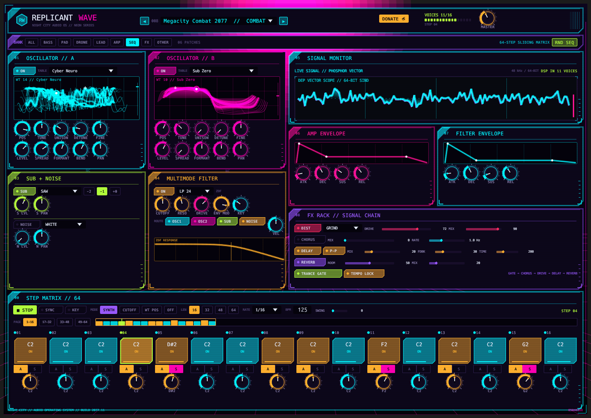

# ⚡ ReplicantWave

<div align="center">


<br/><br/>



<br/><br/>

[](https://paypal.me/DanimanX?locale.x=en_US&country.x=CL)

<p align="center">
  <b>A CPU-Friendly Cyberpunk Wavetable Synthesizer with 64-Step Sliding Sequencer</b><br/>
  <i>Built in pure Rust using NIH-plug and egui. Pure cybernetic sound design for Darksynth, Industrial, and Cyberpunk audio production.</i>
</p>

</div>

---

## ☕ Support the Project

If you love **ReplicantWave** and want to support ongoing development, maintenance, and new features:

👉 **[Support / Buy me a coffee on PayPal (paypal.me/DanimanX)](https://paypal.me/DanimanX?locale.x=en_US&country.x=CL)**

There is also a direct **☕ DONATE** button in the top navigation bar of the plugin itself.

---

## 🌌 Overview

**ReplicantWave** is a next-generation Rust-powered clone and reimagining of the Wavetable architecture, infused with a **Cyberpunk 2077 / Neon Noir** aesthetic and engineered for ultra-low CPU utilization.

Featuring **2 multi-frame wavetable oscillators**, a **64-step neon step-matrix sequencer**, full **Cytomic ZDF multimode filtering**, a multi-algorithm **Cyber Distortion engine**, a live phosphor oscilloscope, a live ZDF filter response, and **38 factory presets** covering bass, pads, drones, leads, arps, sequences and FX for dark electronic music.

---

## 🚀 Key Features

### 🔊 Wavetable Sound Generation
- **2 Dual Wavetable Oscillators**:
  - Continuous frame position morphing with linear & cubic table interpolation.
  - Up to **8 Unison voices** per oscillator with detune, stereo spread, and precomputed phase gains.
  - **Formant Warp** (phase frequency windowing) and **Bend Warp** (non-linear phase curves).
  - Semitone tuning (-36 to +36 st), Fine tuning (-100 to +100 ct), stereo panning, and level gain.
- **Embedded Cyberpunk Wavetable Banks**:
  1. *Analog Morph* (Saw → Triangle → Sine → Square → Pulse)
  2. *Cyber Neuro* (Aggressive folded neuro-bass harmonic morph)
  3. *Digital FM* (Carrier-Modulator dynamic 2-op frequency modulation)
  4. *Vocaloid Synth* (A → E → I → O → U vocal formants)
  5. *Cyber Acid 303* (Resonant harmonic squelch tables)
  6. *Dystopian Steel* (Metallic inharmonic bell to harsh digital grind)
  7. *PWM Hyper* (Continuous pulse-width sweep 50% to 4%)
  8. *Sub Zero* (Deep saturation to wavefolded bass fundamentals)
- **WAV Wavetable Support**:
  - The engine can load standard 256, 512, 1024, or 2048-sample WAV wavetables (Serum/Vital/SocaLabs compatible) through `Wavetable::from_wav_file`.
- **Sub Oscillator**:
  - 6 selectable waveforms: Sine, Triangle, Saw, Pulse 50%, Pulse 25%, Pulse 12%.
  - Octave shifting (-2, -1, 0) and stereo panning.
- **Noise Generator**:
  - White Noise, Pink Noise (Paul Kellet's filter), and CyberBit (quantized digital artifact noise).

### 🎛️ Cytomic ZDF Multimode Filter
- Zero-Delay Feedback (ZDF) state-variable filter based on Andrew Simper's topology:
  - Modes: **LP 12dB**, **LP 24dB** (cascaded), **HP 12dB**, **HP 24dB**, **BP 12dB**, **BP 24dB**, and **Notch**.
  - Non-linear drive saturation (1.0x to 4.0x).
  - Dedicated Filter ADSR Envelope with bipolar modulation depth (-1.0 to +1.0).
  - Per-source routing matrix: route or bypass OSC 1, OSC 2, Sub, and Noise independently.
  - Key tracking and Velocity tracking.

### 🎛️ Full Host Automation (84 parameters)
- **Every control is a parameter.** All 84 knobs, toggles and selectors are exposed to VST3/CLAP/AU, so the DAW can automate them, MIDI-learn them from the generic UI, and remote-control them from hardware — not just master, cutoff and resonance.
- **Tidy parameter tree** with host-side groups: `Oscillator 1`, `Oscillator 2`, `Sub Oscillator`, `Noise`, `Filter`, `Amp Envelope`, `Filter Envelope`, `Distortion`, `Chorus`, `Delay`, `Reverb`, `Trance Gate`, `Sequencer`.
- **Gesture-correct editing**: knobs send begin/set/end parameter gestures, so touch/latch automation recording works and the host shows the automated value moving in the plugin.
- **One-way data flow**: the editor writes parameters only, and the audio thread mirrors them into the DSP engine once per block. Automation, presets and the GUI can never disagree.
- **Legacy IDs preserved**: `gain`, `cutoff` and `resonance` keep their original IDs so automation written with 1.0.x still resolves.
- **Session restore**: the 64-step pattern is persisted with the host session (it is pattern data, not a control surface), so reopening a project restores your sequence.

### 🎛️ Neon HUD Controls
- **Rotary knobs**: 11 machined tick marks, dark glass cap, glowing value arc, bright needle and hover readout. Mouse-wheel support, fine-tune drag (`Shift`), and double-click reset.
- **HUD sliders**: compact glowing horizontal controls for the FX rack, with live value readouts.
- **Cut-corner glass panels**, animated scanlines, a synthwave floor grid and neon corner brackets — a pure NIGHT CITY HUD, no hardware screws or patch cables.

### 🔮 3D GPU-Accelerated Animated Holographic Wavetable Engine
- **Orbital 3D Perspective Waterfall Mesh**: Dynamic 3D undulating terrain rendered directly via hardware GPU triangles (`egui::Mesh`) with depth fog, dynamic perspective tilt, and wireframe ribbons.
- **Sweeping Depth Laser Scanner**: Sweeps back and forth through depth, casting glowing highlights on terrain slices.
- **Living hologram**: the wavetable views animate continuously at 60 FPS — orbital camera breathing, a traveling depth scan, per-slice ripple, a pulsing active wave, a peak marker and an orbiting energy orb. The display auto-fits the hottest wavetable so no trace is ever clipped by the viewport.
- **Monotonic GUI clock**: animation uses a process-local `Instant` (`gui::time`), never `SystemTime` epoch seconds. An `f32` cannot resolve ~213 s steps at a Unix timestamp, which previously froze every animation.

### ⚡ 64-Step Neon Step Matrix
- **Full-width deck** with transport, mode, length and rate always visible.
- **Interactive 64-Step Radar**: gate status, accent, pitch, active playhead and a page viewport bracket.
- **Page navigation**: `[1-16]`, `[17-32]`, `[33-48]`, `[49-64]`, with optional playhead follow.
- **MIDI / transport behaviour**:
  - Incoming MIDI notes **always play the synth** and **never start the sequencer**.
  - **PLAY** starts the internal sequencer. **SYNC** (opt-in) follows the DAW transport.
  - **KEY TRIG** (opt-in) transposes a sequence that is already running; it cannot start one.
  - **FREE RUN** uses the internal BPM clock (40–240 BPM).
- **Per-Step Controls**:
  - Cut-corner gate pad with note name, velocity bar and live playhead glow.
  - Pitch knob (-24 to +24 semitones, real-time note display).
  - Accent (`A`) and slide (`S`) flags. Slide is true TB-303 legato without envelope retrigger.
- **Sequencer Modes**: *Internal Synth*, *Cutoff Mod*, *WT Pos Mod*, *Off*.
- **Clock & Groove**: 1/4, 1/8, 1/8T, 1/16, 1/16T, 1/16D, 1/32; swing 0–75%; musical `RND SEQ` pattern generator.

### 🧪 Cyberpunk Multi-FX Engine
- **Trance Gate**: 16-step stereo rhythmic chopper with attack/release smoothing.
- **Stereo Chorus**: Dual LFO modulated delay lines with stereo width.
- **Cyber Distortion**: *Overdrive*, *Bitcrusher*, *Fire Amp* and *Grind Amp* algorithms.
- **Ping-Pong Delay**: Tempo-synced stereo delay with damped feedback.
- **Diffusion Reverb**: Algorithmic stereo plate/hall reverb with tuned comb/allpass diffusion.
- **Click-free bypass**: every FX block crossfades over 4 ms and the master output is smoothly saturated, so toggling presets or effects does not click.

### 🔋 CPU-Friendly Ultra-Optimized DSP Architecture
- **Eliminated CPU Spikes**: Precalculated envelope decay/release multipliers eliminate transcendental `.exp()` in the sample loop; cached SVF coefficients avoid `tan()` per sample; unison phase gains precalculated outside loops.
- **Zero Audio-Thread Allocations & Lock-Free Scope**: Scopes decoupled from per-sample loop for sub-millisecond block execution.
- **Voice Inactivity Sleeping**: Inactive voices immediately exit the processing loop once their envelopes finish.

---

## 🎚️ Factory Presets (Cyberpunk Soundbank)

ReplicantWave ships with **38 factory patches** across seven banks. Every patch is rendered offline by `tests/preset_audio_test.rs` and checked for NaNs, silence, DC offset, runaway loudness and hard clipping.

**BASS** — Night City Bass · Subdermal 808 Rumble · Combat Zone Bass · Chrome Sub Assault · Neuro Reaper Bass · Acid Rain Bass

**PAD** — Arasaka Matrix Pad · Synthetic Tears Pad · Neon Rain Pad · Corpo Cathedral · Ghost Protocol Choir · Cryo Sleep Pad · Ghost In The Wire Choir · Braindance Memory

**DRONE** — Corpo Tower Dystopia · Blackwall Drone · Toxic Fog Drone · Singularity Hum · Arasaka Orbital Drone

**LEAD** — Neon Blade 2049 · Darksynth Power Stab · Chrome Acid 303 · Overclocked Sync Screamer · Nightside Razor Lead · Laser Katana · Neon Samurai Lead · Void Screamer Lead

**ARP** — Netrunner Arp · Data Stream Arp · Kiroshi Rain Arp

**SEQ** — Cyber Glitch 64-Step · Kiroshi Scanner Sequence · Megacity Combat 2077 · Afterlife Future Rave · Afterlife Run · Braindance 64

**FX** — EMP Burst · Cyberpsychosis

---

## 🛠️ Building & Packaging from Source

### Prerequisites
- [Rust 1.85+ (MSRV)](https://www.rust-lang.org/tools/install)
- ALSA / JACK / OpenGL dev headers (Linux):
  ```bash
  sudo apt-get install -y libasound2-dev libgl1-mesa-dev libx11-xcb-dev libxcb1-dev libxcb-render0-dev libxcb-shape0-dev libxcb-xfixes0-dev libjack-jackd2-dev
  ```

### Build Everything
```bash
# Clone the repository
git clone https://github.com/DanimanX/ReplicantWave.git
cd ReplicantWave

# Build release standalone executable and plugins
cargo xtask bundle replicantwave --release
cargo build --release --bin replicantwave-standalone
```

Compiled bundles will be generated in `target/bundled/`:
- `target/bundled/replicantwave.vst3`
- `target/bundled/replicantwave.clap`
- `target/release/replicantwave-standalone`

---

## 📜 License

ReplicantWave is licensed under the [MIT License](LICENSE).
Created with ⚡ by Daniel Rojas (`daniel.rojas@chileatiende.cl`).
